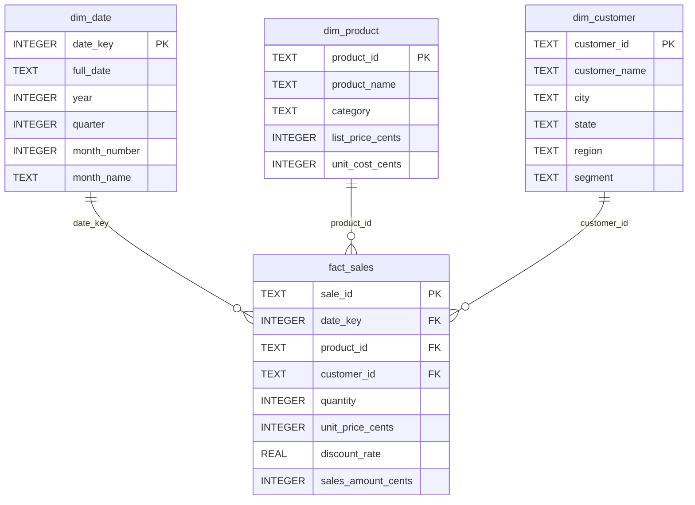
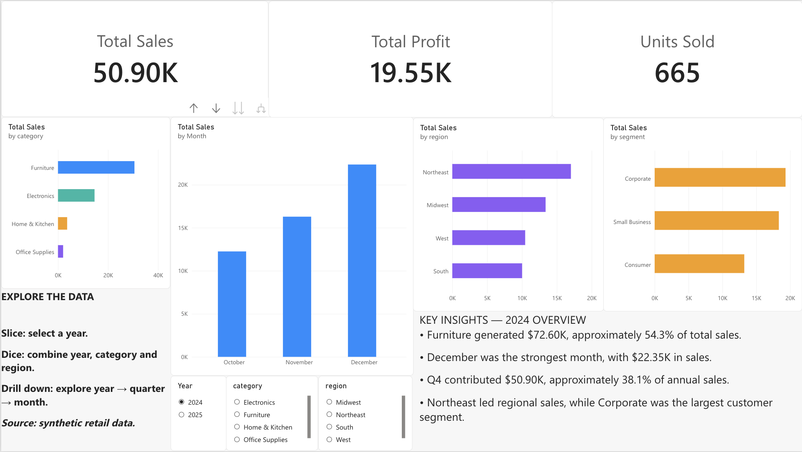

# Retail Sales Data Warehouse and OLAP Analysis

A reproducible retail analytics project using **Python, SQLite, DataGrip, and Power BI** to clean departmental data, build a star schema, and explore sales through slice, dice, and drill-down operations.

All retail records are **synthetic**, generated with OpenAI ChatGPT on October 25, 2026. Customer names are placeholders. ChatGPT also assisted with the code, schema, SQL, and dashboard planning. Findings describe simulated transactions and are not evidence about an actual business.

## Workflow and scope

`raw CSVs → Python cleaning → SQLite star schema + cleaned CSV exports → Power BI semantic model`

Power BI used the **cleaned CSV exports from the SQLite warehouse**, with relationships recreated in its semantic model—not a direct SQLite connection. This import workflow is documented from the project owner's account. A supplied dashboard screenshot is included below and its displayed totals were checked against SQLite. No editable PBIX/PBIP report file was supplied, so semantic-model configuration, DAX definitions, and interactive behavior could not be independently inspected. DataGrip serves as the SQL inspection/query client; no private connection profiles are included.

## Cleaning and verified counts

| Dataset | Raw rows | Exact duplicates removed | Rejected | Final rows |
|---|---:|---:|---:|---:|
| Products | 26 | 2 | 0 | 24 |
| Customers | 124 | 4 | 0 | 120 |
| Sales lines | 1,224 | 24 | 15 | 1,185 |
| Calendar | Generated | — | — | 731 |

The standard-library build script:

- Removes exact duplicate records; trims and normalizes product/customer IDs.
- Standardizes category labels, state codes, and customer segments; derives region from state.
- Normalizes slash-separated dates to ISO dates and rejects invalid dates, nonpositive quantities, and unmatched dimension IDs. Returns are outside this exercise.
- Parses currency and percent discounts, recovers 8 missing prices from the fixed catalog, and recalculates 20 missing or incorrect sales amounts after discounts.
- Stores money as integer cents using decimal half-up rounding; emits rejected rows and a repair audit log.
- Generates the full 2024–2025 calendar, checks foreign keys and SQLite integrity, and reconciles sales totals.

Repairs are events and can overlap on a sales line. Duplicate removal precedes rejection. See `validation.json`, `cleaned/rejected_sales.csv`, and `cleaned/repair_log.csv`.

## Star schema

One `fact_sales` row is one accepted sales transaction **line**, identified by sale_id; it is not necessarily a complete customer order. Each dimension has a one-to-many relationship to the fact table.



`dim_product` provides fixed catalog prices/costs; `dim_customer` provides geography and segment; `dim_date` supplies the calendar hierarchy. The SQLite database also includes a flattened `sales_for_dashboard` convenience view, but the Power BI model uses the four separate exported tables.

## OLAP SQL

Run the complete examples in `olap_queries.sql`. These abbreviated examples illustrate each operation.

**Slice:** hold year fixed and compare categories.

```sql
SELECT p.category, ROUND(SUM(f.sales_amount_cents)/100.0,2) AS sales_usd
FROM fact_sales f
JOIN dim_product p USING(product_id)
JOIN dim_date d USING(date_key)
WHERE d.year = 2025
GROUP BY p.category;
```

**Dice:** select a subset across multiple dimensions.

```sql
SELECT p.category, c.region,
       ROUND(SUM(f.sales_amount_cents)/100.0,2) AS sales_usd
FROM fact_sales f
JOIN dim_product p USING(product_id)
JOIN dim_customer c USING(customer_id)
JOIN dim_date d USING(date_key)
WHERE d.year = 2025
  AND p.category IN ('Electronics','Furniture')
  AND c.region IN ('Northeast','West')
GROUP BY p.category, c.region;
```

**Drill-down:** move from year to quarter to month. The full SQL file returns all three levels with UNION ALL; never add totals across aggregation levels.

```sql
SELECT d.year, d.quarter, d.month_number,
       ROUND(SUM(f.sales_amount_cents)/100.0,2) AS sales_usd
FROM fact_sales f JOIN dim_date d USING(date_key)
GROUP BY d.year, d.quarter, d.month_number
ORDER BY d.year, d.quarter, d.month_number;
```

## Power BI measures and visuals

Import the four cleaned model CSVs and recreate the relationships shown above with single-direction dimension-to-fact filtering. Use Date for full_date, and sort month_name by month_number. See `POWER_BI_PLAN.md` for the import and visual configuration guide and `measures.dax` for all measures.

```dax
Total Sales = SUM(fact_sales[sales_amount_cents]) / 100

Units Sold = SUM(fact_sales[quantity])

Gross Profit =
SUMX(
    fact_sales,
    fact_sales[sales_amount_cents]
        - fact_sales[quantity] * RELATED(dim_product[unit_cost_cents])
) / 100
```

Gross profit is discounted sales less catalog product cost; **it excludes operating expenses** and is not net profit. The added Gross Profit measure was reconciled using equivalent SQL; DAX execution was not tested in Power BI here.

### Dashboard screenshot



The supplied screenshot shows Total Sales, Total Profit, and Units Sold cards; sales charts by category, month, region, and segment; and year, category, and region slicers. It also displays drill controls and instructions for year → quarter → month exploration. The selected year is 2024 and the monthly chart shows October–December. The cards reconcile to **2024 Q4**: $50,897.24 sales (50.90K), $19,547.93 gross profit (19.55K), and 665 units. Although the card says “Total Profit,” the reconciled calculation is gross profit before operating expenses.

The static “2024 Overview” insight text describes the **full year**, a different scope from the visible Q4 cards/charts. Its claims also reconcile: Furniture sales were $72,602.14 (54.3% of annual sales), December led at $22,353.21, and Q4 represented 38.1% of annual sales. Northeast led full-year regional sales and Corporate led full-year segment sales. Readers should keep these scopes separate; an editable report would be needed to inspect the filter/drill configuration or make the insight text dynamic.

`POWER_BI_PLAN.md` distinguishes the observed visuals from additional suggested configurations. The screenshot verifies visible content, not the underlying model relationships, measure formulas, or slicer interactions.

## Verified findings

| Metric | Value |
|---|---:|
| Total sales | $295,490.58 |
| Units sold | 4,131 |
| Catalog cost of goods sold | $180,401.33 |
| Gross profit before operating expenses | $115,089.25 |
| 2024 sales | $133,636.17 |
| 2025 sales | $161,854.41 |

Furniture leads full-period category sales at $161,835.61, followed by Electronics ($86,298.55), Home & Kitchen ($33,063.18), and Office Supplies ($14,293.24). In the 2025 slice, Furniture contributes $89,233.47. These are descriptive findings from synthetic data, not causal conclusions or forecasts.

## Installation and reproduction

Use Python 3 (verified with the installed Python 3 interpreter), its standard library, and optionally the SQLite CLI or DataGrip. No pip dependencies are required. Power BI Desktop is needed to reproduce the semantic model and visuals.

```sh
git clone https://github.com/Timer-Senarith/retail-sales-data-warehouse-olap.git
cd retail-sales-data-warehouse-olap
python3 build_warehouse.py
sqlite3 -header -csv retail_warehouse.sqlite < olap_queries.sql
```

The script locates inputs relative to its own file, so retain the folder structure. It rebuilds the generated database tables and overwrites cleaned exports and `validation.json`; use a separate clone/copy to preserve existing outputs. It does not regenerate the raw synthetic data or the stored `query_results` exports. The SQL CLI prints three result sets; in DataGrip, open the SQLite file as a data source and execute the three queries separately to inspect/export each result.

For an independent totals check:

```sql
SELECT SUM(f.quantity) AS units_sold,
       SUM(f.sales_amount_cents)/100.0 AS total_sales,
       SUM(f.sales_amount_cents-f.quantity*p.unit_cost_cents)/100.0 AS gross_profit
FROM fact_sales f JOIN dim_product p USING(product_id);
```

Publication verification rebuilt an isolated temporary copy, leaving original outputs intact. All six generated cleaned/audit CSVs and `validation.json` matched byte-for-byte; all four database tables and the view matched logically. SQLite integrity passed, no foreign-key violations were found, and all existing SQL exports matched (4 slice, 4 dice, 34 drill-down rows). `verification_results.json` records these checks and findings. An initial verification harness split a semicolon inside a SQL comment and failed; after stripping comment lines, verification passed. The project build itself ran successfully.

## Repository structure

```text
.
├── README.md
├── .gitignore
├── build_warehouse.py
├── raw/                         # Synthetic products, customers, sales
├── cleaned/                     # Four model tables, rejection and repair logs
├── retail_warehouse.sqlite
├── olap_queries.sql
├── query_results/               # Slice, dice, drill-down CSV results
├── validation.json              # Builder validation output
├── verification_results.json    # Independent publication checks
├── screenshots/PowerBI.png       # Supplied dashboard screenshot
├── star_schema.mmd
├── measures.dax
└── POWER_BI_PLAN.md              # CSV import/model and visual reproduction guide
```

## Limitations

This is a small, fixed teaching dataset with hard-coded expected counts and a 2024–2025 calendar. It is not a general-purpose production ETL pipeline: unanticipated malformed fields can fail the build, and conflicting normalized dimension IDs are not explicitly audited. Costs use the fixed catalog rather than historical cost records; returns, inventory, operating expenses, and slowly changing dimensions are not modeled. A dashboard screenshot is included, but no hosted dashboard or editable Power BI report file is available. DataGrip and Power BI interactions were not independently replayed during publication. No private course links, instructor materials, or classmates' work are included.
